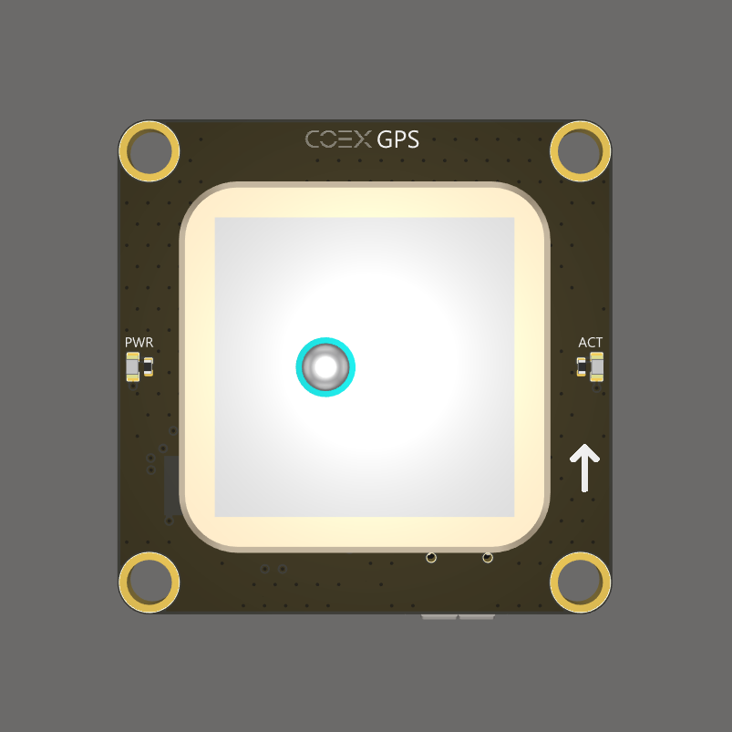
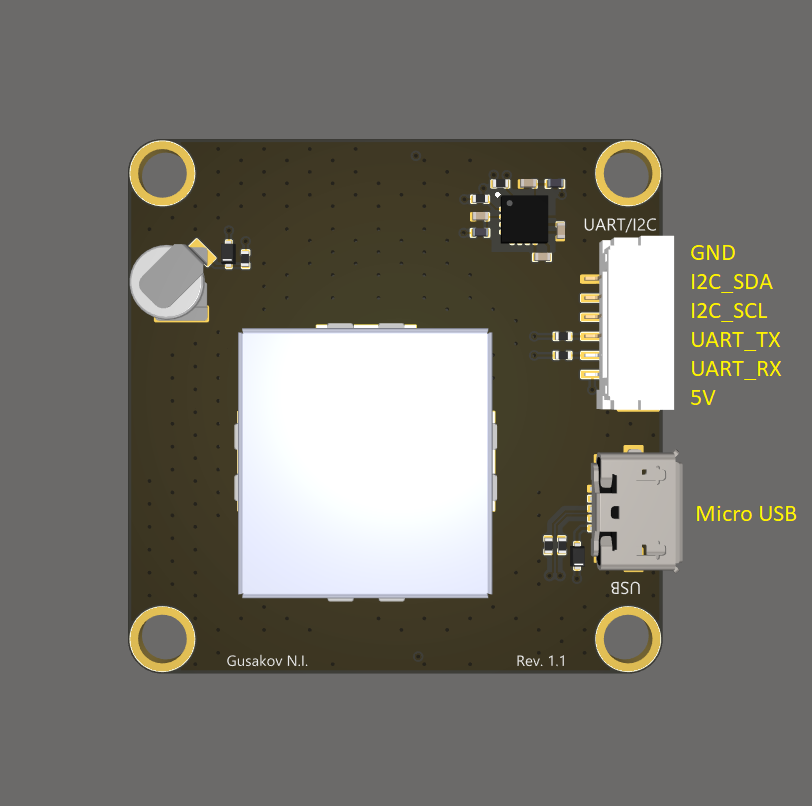

# SKYRIS GPS

ГНСС-приемник **SKYRIS GPS** совместим с полетным контроллером [SKYRIS Pix](skyris_pix.md). Этот приемник поставляется с наборами SKYRIS Клевер 4 Pro.

> **Hint** Исходные файлы платы SKYRIS GPS [выложены](https://github.com/CopterExpress/hardware/tree/master/COEX%20GPS) в открытый доступ под лицензией CC BY-NC-SA.

## Схемы расположения контактов

### Вид сверху

### Вид снизу

